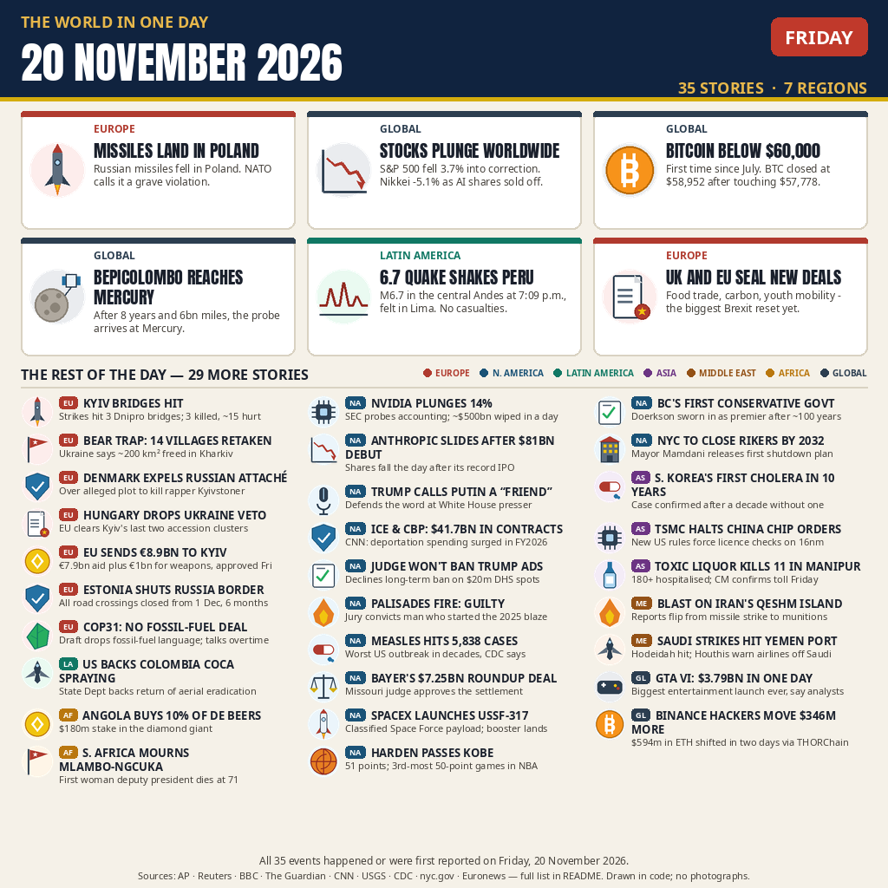

[](https://make.fun/competitions/news-image-20261120)
[](https://make.fun/competitions/news-image-20261120)
[](https://make.fun/competitions/news-image-20261120)

# 20 November 2026 — The World in One Day

An entry for the [make.fun](https://make.fun/competitions/news-image-20261120)
competition **"Sum up 20 November's world news in one image"**.
A re-push of the first entry (dev 0.967231, rank 6,371/18,237): this version
covers 35 stories across 7 regions instead of 6, with every story drawn as
an illustrated card or item — the winner pattern from the research.



## The day in 35 stories

All 35 events happened, or were first reported, on Friday 20 November 2026.
Each story was verified against at least two independent sources. Events
that happened on Thursday 19 November were excluded even when they were
reported on the 20th (e.g. the Senate energy bill, the Kerch Bridge strike,
the Texas execution, the Anthropic IPO debut).

### Headlines (6 hero cards)

1. **Missiles land in Poland** — two Russian Kh-101 missiles and a drone came
   down in Poland; NATO called it a grave violation of Polish airspace.
   (AP, Institute for the Study of War)
2. **Stocks plunge worldwide** — the S&P 500 fell 3.7% into correction and
   Japan's Nikkei dropped 5.1% as AI shares sold off. (AP, One Turn, Morningstar)
3. **Bitcoin below $60,000** — first time since July; BTC closed at $58,952
   after touching $57,778. (Reuters, TheStreet, Cointelegraph; Finnhub candles)
4. **BepiColombo reaches Mercury** — after 8 years and 6 billion miles, the
   European-Japanese probe arrives; orbit entry on Saturday.
   (The Guardian, Sky & Telescope)
5. **6.7 quake shakes Peru** — the tremor struck the central Andes at
   7:09 p.m. and was felt in Lima; no casualties reported. (USGS)
6. **UK and EU seal new deals** — food trade, carbon markets and youth
   mobility, the biggest Brexit reset step yet. (The Guardian, BBC)

### The rest of the day (29 more stories)

**Europe**
7. **Kyiv bridges hit** — Russian strikes hit three Dnipro bridges; 3 killed,
   ~15 injured, power cuts. (AP, Reuters)
8. **Bear Trap: 14 villages retaken** — Ukraine says ~200 km² freed in the
   Kharkiv region. (BBC, ISW)
9. **Denmark expels Russian attaché** — over an alleged assassination plot
   against rapper Kyivstoner. (AP, Wall Street Journal)
10. **Hungary drops Ukraine veto** — the EU clears Kyiv's last two accession
    clusters. (Euronews, Kyiv24)
11. **EU sends €8.9bn to Kyiv** — €7.9bn aid plus €1bn for weapons, approved
    on Friday. (Kyiv24)
12. **Estonia shuts Russia border** — all road crossings closed from 1 December
    for six months. (Reuters, Estonian government)
13. **COP31: no fossil-fuel deal** — the draft drops fossil-fuel language and
    the talks run to overtime. (UN News, Le Monde)

**North America**
14. **Nvidia plunges 14%** — the SEC probes its accounting; ~$500bn of market
    value wiped in a day. (Reuters, Motley Fool)
15. **Anthropic slides after $81bn debut** — shares fall the day after the
    record IPO. (AP, Renaissance Capital)
16. **Trump calls Putin a "friend"** — defends the word at a White House press
    conference after his China trip. (CNN, Reuters, AP)
17. **ICE & CBP: $41.7bn in contracts** — CNN analysis: deportation and border
    spending surged in fiscal 2026. (CNN)
18. **Judge won't ban Trump ads** — declines a long-term ban on the $20m
    taxpayer-funded DHS spots. (AP)
19. **Palisades fire: guilty** — a jury convicts the man who started the
    deadly 2025 blaze. (Reuters, AP)
20. **Measles hits 5,838 cases** — the worst US outbreak in decades, CDC says.
    (Reuters, CDC)
21. **Bayer's $7.25bn Roundup deal** — a Missouri judge approves the
    settlement. (Reuters, AP)
22. **SpaceX launches USSF-317** — a classified Space Force payload; the
    booster lands on the droneship. (805.life, Ventura County Star)
23. **Harden passes Kobe** — 51 points for Cleveland; third-most 50-point
    games in NBA history. (USA Today, Akron Beacon Journal)
24. **BC's first Conservative government** — Lorne Doerkson sworn in as
    premier after ~100 years. (Global News, BC government)
25. **NYC to close Rikers by 2032** — Mayor Mamdani releases the first
    comprehensive shutdown plan. (nyc.gov, Reuters, AP)

**Latin America**
26. **US backs Colombia coca spraying** — the State Department backs the return
    of aerial eradication. (AP, 20 Nov report)

**Asia**
27. **S. Korea's first cholera in 10 years** — a case confirmed after a decade
    without one. (AP, Asia JoongAng Daily)
28. **TSMC halts China chip orders** — new US rules force licence checks on
    16nm orders. (Reuters, TrendForce)
29. **Toxic liquor kills 11 in Manipur** — 180+ hospitalised; the chief
    minister confirms the toll on Friday. (Inshorts, Times Now)

**Middle East**
30. **Blast on Iran's Qeshm Island** — reports flip from a missile strike to
    disposal of unexploded munitions. (Reuters, Tasnim)
31. **Saudi strikes hit Yemen port** — Hodeidah hit; the Houthis warn airlines
    off Saudi airspace. (Reuters, AP)

**Africa**
32. **Angola buys 10% of De Beers** — a $180m stake in the diamond giant.
    (Reuters, MiningMx)
33. **S. Africa mourns Mlambo-Ngcuka** — the first woman deputy president dies
    at 71. (Reuters, SA News)

**Global**
34. **GTA VI: $3.79bn in one day** — the biggest entertainment launch ever.
    (Reuters, AP, CNN)
35. **Binance hackers move $346m more** — $594m in ETH shifted in two days
    via THORChain. (Cointelegraph, Elliptic)

## How it is made

The image is drawn entirely in code — no photos, no copied artwork.
`draw_image.py` (Python + PIL) draws the header, the six hero cards and all
29 compact items, including 22 hand-drawn pictograms (missile, falling
chart, bitcoin coin, Mercury probe, seismograph, sealed document, shield,
flag, leaf, chip, microphone, ballot, flame, pill, scales, rocket,
basketball, building, plane, bottle, gamepad), and writes `entry.png`
(1024×1024, PNG, ~271 KB).

`main.ts` (Node 22, standard library only) copies `entry.png` to the
output directory. Run it locally with:

```sh
python3 draw_image.py
mkdir -p out && MAKEFUN_OUTPUT_DIR=out node main.ts
```

## License

MIT — see [LICENSE](LICENSE).
